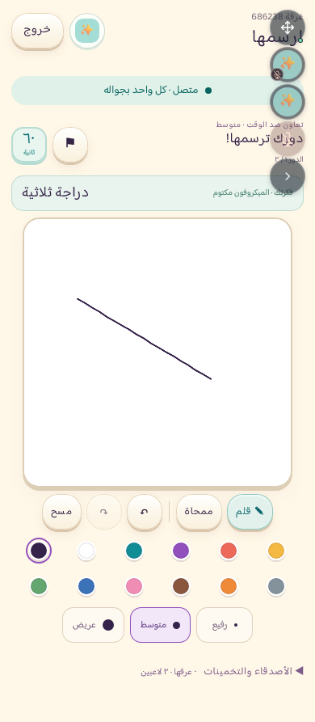

# ارسمها — إصدار التجربة

أُضيفت لعبة رسم حي مستقلة إلى ميدان: تعاون لشخصين ومنافسة لثلاثة إلى ثمانية، من بطاقة الألعاب أو «يلا نلعب» داخل الشلّة. تبقى المكالمة نفسها أثناء اللعب. النسخة مخصّصة لتجربة TestFlight قبل قرار النشر العام.

## ما يتضمنه الإصدار

- غرف خاصة، حساب لكل لاعب، وانضمام مجاني؛ إنشاء المباراة يتبع تجربة ميدان وبلس الحالية.
- اختيار من ثلاث فئات مختلفة خلال عشر ثوانٍ، دقيقة للرسم، وتلميحان متزامنان وكشف لسبع ثوانٍ. الخادم يقرر الحل والنقاط وتسلسل الأدوار.
- لوحة مربعة، قلم وممحاة و12 لونًا وثلاث سماكات وتراجع وإعادة ومسح بتأكيد. تظهر أدوات الرسم كلها بأهداف لمس 44 بكسل في الوضعين الرأسي والأفقي.
- كتم الرسّام قبل عرض الخيارات، مع قفل إلغاء الكتم أثناء الدور. يسمع الآخرين، ويعيد تشغيل الميكروفون بنفسه بعد الكشف.
- سجل دائم للحساب يستبعد اتحاد المفاهيم والعائلات التي شاهدها المشاركون. تُخطّط المباراة كاملة قبل خصم التجربة، ويمنع حجز الحساب في مباراتين متزامنتين. الاستنفاد يطلب توسيع الفئات أو إعادة صريحة.
- تجميع نقاط الرسم كل نحو 80 مللي ثانية، وتثبيت التغييرات قبل تأكيدها وبثها، واستعادة اللوحة بعد إعادة الاتصال. تبقى الرسومات مؤقتة، ويحتفظ البلاغ فقط بدليل خاص للمشرفين وفق سياسة الحذف والاحتفاظ.
- تُستخدم واجهات WebSocket الحالية مع حفظ الحالة اللازم للاستعادة بعد السبات؛ مرجع النقل هو [توثيق Cloudflare](https://developers.cloudflare.com/durable-objects/best-practices/websockets/).

## المحتوى

بنك خادمي من 1,200 مفهوم في 12 فئة، بتوزيع 360 سهلًا و600 متوسط و240 تحديًا. لا يحمل تطبيق الآيفون أو بناء المتصفح بنك الحلول أو القرائن الخاصة. أُبقي 566 بندًا وعُدّل 634 بعد مراجعة تحريرية مستقلة بواسطة وكيل ثانٍ، مع توثيق قرار كل بند وبصمته.

السجل الكامل للمراجعة في [مراجعة المحتوى](../../ersomha/content-review.md). هذه مراجعة تحريرية وليست تجربة لاعبين؛ يوجد 23 بندًا موسومًا لقياس ألفة المصطلح. لا يعد البنك بمحتوى لا نهائي ولا بإلغاء الحاجة إلى تقييم الغموض والمتعة بشريًا.

## التحقق

| الفحص | النتيجة والنطاق |
|---|---|
| حزمة الاختبارات | Windows: ‏959/959 دون تخطٍ. CI: ‏958 ناجحًا وتخطٍ واحد لأن `dist` لم يُجهّز بعد، دون فشل |
| أدوات الآيفون | CI: ‏40/40. Windows: ‏39 ناجحًا وتخطٍ واحد لغياب مترجم Swift؛ ليست تجربة جهاز |
| الواجهة | Chromium وWebKit، غرفة فعلية محلية ومكالمة بوسيط صوت محاكى، كل الأدوات في الشاشة، كتم الرسام، والعودة دون اتصال صوتي جديد |
| المخطط والسجل | 3,633 مباراة مخططة في 42 إعدادًا، و11,181 استدعاء للمخطط؛ السجل محاكى محليًا، وليست آلاف غرف شبكة |
| الخادم البعيد والتخزين | 10/10 على بيئة معزولة: غرف شخصين وثلاثة وثمانية، السجل، سباق الحجز، الاستنفاد، الإبلاغ والحذف؛ تنظيف كامل |
| الصوت الفعلي | 7/7 على TestLab منفصل، و12 مشاركًا مع صوت فعلي وإبطال التوكنات وwebhooks وتنظيف كامل |
| بث الرسم | ثمانية عملاء على workerd محلي، دفعات 80ms وتأخير شبكة ذهاب وإياب 120ms: P95 = 235.15ms، و420/420 تسليمًا |
| شبكة أبطأ | تأخير ذهاب وإياب 480ms: P95 = 592.1ms و420/420 تسليمًا؛ هدف 250ms لا ينطبق على هذه الحالة |
| القياس المحلي للقلم | 61 عينة في كل متصفح؛ P95 Chromium = 0.4ms وWebKit = 4ms. القياس من حدث المؤشر إلى رسم بكسل قابل للقراءة، لا إلى عرضه على شاشة جهاز فعلي |

قياسات المتصفح والسجل والمزوّد منفصلة؛ لا يثبت أي منها وحده متعة اللعبة أو أداء الآيفون الحقيقي. تجربة الجهازين ثم المجموعة مطلوبة وفق [قائمة التجربة](iphone-trial-checklist-ar.txt).

## المعاينة

[الوضع الأفقي](iphone-landscape-preview.png) · [النتيجة التعاونية](cooperative-result-preview.png)

## التسليم

مصدر التطبيق المجمد: `f23033d5364b6cdda1df851ed2aa9ee9bdbb69ba`. اكتمل البناء الموقّع **1.8 (19)** وقبلته Apple بحالة `VALID` ثم `IN_BETA_TESTING`، وأصبح متاحًا للمختبر الداخلي الموجود. حُفظت تعليمات التجربة وتحقق تطابقها عبر واجهة Apple الرسمية. إيصال التسليم في [testflight-delivery.json](testflight-delivery.json)، وفحص الحزمة في [package-audit.json](package-audit.json)، وفحص المحاكي في [native-launch-verification.json](native-launch-verification.json). تحقق التوقيع التشفيري للأرشيف مثبت في CI؛ فحص Windows للحزمة المصدرة لا يثبت التوقيع التشفيري مستقلًا. تجربة آيفون فعلي ما زالت مطلوبة.

أُلغي بناء وسيط قبل التوقيع والرفع بعد اكتشاف الحاجة لضبط الارتفاع في شاشة الهاتف؛ خطوة الرفع فيه متخطّاة، ولذلك ظل الرقم 19 متاحًا للبناء النهائي. لم يُرسل إصدار عام أو يُلغ طلب مراجعة Apple الحالي، وتظل سياسة التحديث الإجباري معطلة.

نُشرت إضافات الخادم فقط بعد نسخة احتياطية وفحص البصمات، دون تغيير موارد الويب العامة الـ63. ظل طلب **1.7.1 قيد انتظار المراجعة**. يبدأ إصدار ارسمها العام بعد تجربة الآيفون ومراجعة وضوح الكلمات ومتعة اللعب.
