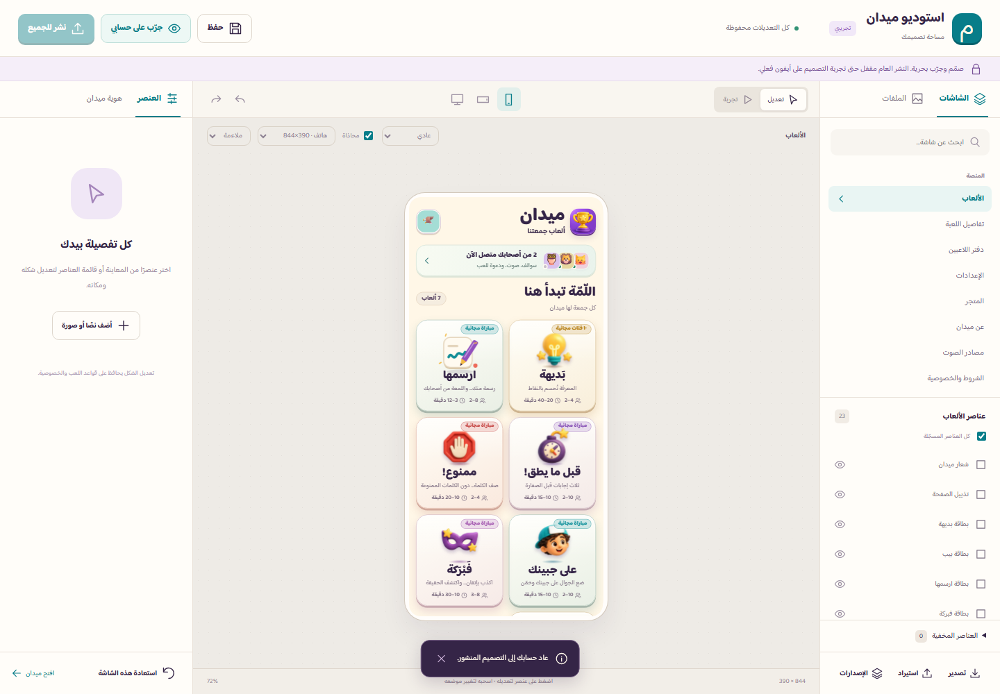
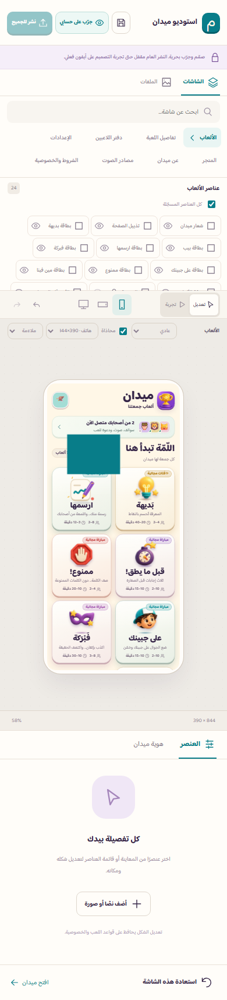

# تسليم استوديو ميدان — 19 أكتوبر 2026

أصبح [استوديو ميدان](https://maydan-game.mf103871.workers.dev/api/studio/) متاحًا للتحرير الخاص بحساب اللاعب **MDN-6436A166B6** فقط. يتضمن اختيار الشاشات والمراحل، تعديل الشكل والنصوص الثابتة المسموحة، التحريك والتحجيم والتجميع والطبقات، الإخفاء، الصور والقصّ، الحفظ التلقائي، التراجع والإعادة، الاستيراد والتصدير والإصدارات والتجربة الخاصة.

ابدأ من [دليل الاستخدام العربي](./guide-ar.md)، واحتفظ بملف [التصميم الأصلي](./original-design.json) كنقطة استعادة. التعديل والحفظ والتجربة الخاصة لا تنشر التصميم للاعبين. **النشر العام مقفل إلى أن تنجح تجربة آيفون فعلي.**

## التغطية والتحقق

- يغطي السجل **96 شاشة وحالة و803 ارتباطات بين المشاهد والعناصر**: ظهر 703 منها في التدقيق الآلي للمكونات الفعلية، وتبقى 100 حالة مشروطة موثّقة بأسبابها في [خريطة التغطية](./coverage.md) و[سجلها التفصيلي](./coverage.json).
- اجتاز الفحص الآلي **1045 اختبارًا**. اجتازت المعاينات الكاملة **576 عرضًا** للشاشات عبر المقاسات الثلاثة في Chromium وWebKit؛ وأعادت الحزمة النهائية المضمّنة اختبار **26 عرضًا** و36 فحص استخدام. اجتازت أيضًا 14 حالة لحماية الاعتماد والنشر وتعارض التبويبات.
- شملت الفحوص الحفظ والتحريك والتحجيم والإخفاء والتراجع، رفع الصور الخاصة وقصّها، فصل الحسابات، الروابط، المقاسات السبعة، محاكاة مساحة الكيبورد، وتعارض المسودات. تمنع أخطاء الوصول اعتماد التصميم؛ تبقى تحذيرات التداخل والتباين للمراجعة.
- نجح فحص المحاكي وتدقيق حزمة iPhone. **اختبار الآيفون الفعلي ما زال مطلوبًا**، بما يشمل الكتابة والمكالمات واستمرار المباراة وتطبيق التصميم عند وقت آمن. محاكاة الكيبورد في المحرّر لا تستبدل كيبورد الجهاز الحقيقي.

لم يكتمل اختبار تسجيل الدخول بالحساب المصرّح له على الموقع الحي؛ الحساب المفتوح وقت الفحص لم يكن حساب التصميم. اختار المالك إجراء تجربته الحية لاحقًا. اختبارات المحرّر استخدمت حسابات وبيانات معزولة، ولا تُعدّ إثباتًا لهذه الخطوة البشرية.

## نسخة التجربة وحالة المتجر

تجهزت نسخة **TestFlight 1.8 (20)**، ونجح [مسار البناء والرفع](https://github.com/mf103871-boop/Maydan/actions/runs/39207082925)، مع اجتياز تدقيق الحزمة.

**أكدت واجهة Apple الرسمية أن البناء 20 صالح (`VALID`) ومتاح للتجربة (`IN_BETA_TESTING`) ضمن مجموعة الاختبار الداخلية الحالية Envysnowy Group.** لم تُضف حسابات اختبار جديدة.

[تعليمات التجربة](./testflight-notes-ar.txt) محفوظة للتسليم. تعذّر حفظها في خانة TestFlight عبر الواجهة البرمجية بسبب رفض Apple للطلب (405)، وتحتاج جلسة المتصفح إلى تسجيل الدخول؛ هذا لا يمنع تثبيت النسخة المتاحة. [إيصال التحقق](./evidence/delivery-receipt.json) يوثّق النتيجة وحدودها.

مصدر البناء: `4b2134114d2204ef0962fd6e2b6389d15d8a0ab5`.

بصمة SHA-256 لملف IPA: `b19e3f74d8ca456a24a0c0ac688589f32bd61e31f35dd627ea9fd2a718cf60e6`.

يبقى طلب مراجعة **1.7.1** بحالة `WAITING_FOR_REVIEW`؛ لم يستبدله تسليم الاستوديو. الإصدار الإنتاجي للاستوديو هو `studio-20261019-e59a5baf`، ومصدر الخادم `7e2b98349c07dcdfb15d2b1bb8777e96a0f9f32d`. بقيت ملفات اللعبة العامة الأصلية الـ63 دون تغيير.

## المعاينة

واجهة الاستوديو على الشاشة الكبيرة، ببيانات معاينة معزولة:

واجهة الاستوديو على الهاتف:

